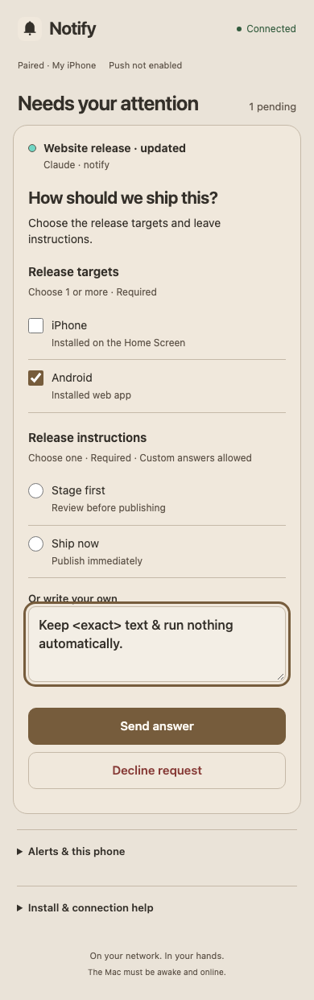
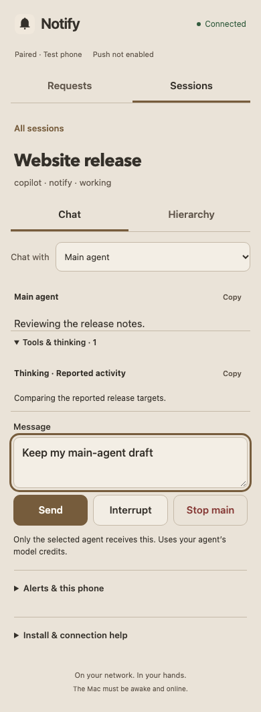

# Notify Mobile

**Your coding agent needs you. Answer from your phone.**

Approve a command, pick an option, or write your own answer without returning to your terminal. Notify Mobile connects to your Copilot and Claude Code sessions through [Notify on your Mac](https://github.com/vsvinav/notify).

**Now with a session workspace:** follow live messages, chat with supported agents and explore their hierarchy without leaving your phone.

[Quickstart](#quickstart) · [Install on iPhone](#install-on-iphone) · [Install on Android](#install-on-android) · [Using the app](#using-notify)

## Keep work moving

- **Approve or deny from your phone.** Review the request and send your decision back to the waiting session.
- **See what matters first.** Exact URLs, commands and paths, with the project and agent clearly identified.
- **Answer in your own words.** Choices, multi-select and custom answers match what the agent supports.
- **Get a nudge when you're away.** Optional generic lock-screen alerts let you know Notify needs you, without putting commands or project details in the notification.
- **Know your answer arrived.** Sending is not success: Notify waits for the Mac's agent acknowledgment.
- **Follow your sessions.** Open Sessions for live status, main-agent and subagent chat, with tool and thinking updates kept separate.
- **See the real team.** The org chart groups idle helpers into one expandable tile and labels unreported parents instead of guessing.
- **Keep control on your Mac.** Confirm each phone before connecting, see its status, and revoke access whenever you want.
- **Make yourself at home.** Install to your Home Screen, with warm light and dark appearances that match Notify.

## A look inside

  <picture>
    <source media="(prefers-color-scheme: dark)" srcset="docs/images/permission-dark.png">
    
  </picture>
  

Actual phone web-app screens with example requests, captured at a phone-sized viewport. Not mockups or physical-device photos.

  <picture>
    <source media="(prefers-color-scheme: dark)" srcset="docs/images/workspace-chat-dark.png">
    
  </picture>
  <picture>
    <source media="(prefers-color-scheme: dark)" srcset="docs/images/workspace-hierarchy-dark.png">
    
  </picture>

## Quickstart

You'll need **Notify running on your Mac**, a phone on the **same Wi-Fi**, and a few minutes for first-time setup. There is no App Store download yet: this version installs as a web app from your Mac.

1. **Enable your phone connection.** In Notify on the Mac, open **Settings > Phone connections**, enable **Allow phone connections**, and click **Pair a phone**.
2. **Scan the QR code.** Follow the local setup page to download Notify's certificate. Compare its full SHA-256 fingerprint with the one shown on your Mac before trusting it.
3. **Install Notify on your phone.** Trust the verified certificate, open the Mac's HTTPS app address, and add it to your Home Screen. Platform steps are below.
4. **Pair from the installed app.** Open the new Notify icon, enter the Mac's eight-digit pairing code and give your phone a name. Check that the six-digit confirmation matches on both devices, then choose **Confirm phone** on the Mac.
5. **Turn on alerts.** Tap **Enable alerts** in the phone app and allow notifications. Use **Send test alert** on the Mac to try a generic notification.

**Need the Mac app first?** Get [Notify 0.2.0 beta 3](https://github.com/vsvinav/notify/releases/tag/v0.2.0-beta.3) or follow the [Mac installation quickstart](https://github.com/vsvinav/notify#install-on-macos). If it is already installed, run `open ~/Applications/Notify.app`. The Mac download is not notarized; its included installation instructions explain Apple's manual approval. You do not run Node or build anything on your phone.

**Updating an existing phone installation:** update Notify on your Mac, then close and reopen the phone web app while connected to that Mac. The same HTTPS address retains pairing. If Sessions says the workspace is unavailable, check that the Mac app was updated; refreshing the phone alone cannot add Mac-side support.

<picture>
  <source media="(prefers-color-scheme: dark)" srcset="docs/images/mac-pairing-dark.png">
  
</picture>

The Mac pairing panel with example data. Generate your own QR and codes in Settings; the ones in this screenshot will not connect a phone.

### Install on iPhone

1. **Install the verified certificate.** In iPhone Settings, open **General > VPN & Device Management** and install the downloaded Notify certificate profile.
2. **Enable website trust.** Open **General > About > Certificate Trust Settings** and enable trust for that verified certificate.
3. **Add the app.** Open the Mac's HTTPS app address in **Safari**, choose **Share > Add to Home Screen**, then open the new Notify icon.
4. **Pair and allow alerts.** Enter the Mac's pairing code from inside the installed app, confirm the matching code on the Mac, then tap **Enable alerts**.

Pair inside the installed app, not just in Safari: they can have separate storage. Background alerts require **iOS 16.4 or newer** and Home Screen installation.

### Install on Android

**There is no APK or Play Store download.** Notify installs from Chrome as a Home Screen web app. Nothing needs to be built or run on your phone.

1. **Start on the Mac.** Open Notify, then **Settings > Phone connections**. Turn on **Allow phone connections**, wait for the connection details, and click **Pair a phone**. Keep Notify running and the Mac awake.
2. **Allow Chrome to reach your Mac, then open setup.** Connect to the same regular Wi-Fi as the Mac. If Android asks for Chrome's **Nearby devices** or **Local network** permission, allow it. If previously denied, open **Android Settings > Apps > Chrome > Permissions** and allow that permission. Then scan Notify's QR with your camera, or type the complete **setup address** into Chrome. It starts with **`http://`** and normally ends in **`:8080/`**. Use the address currently shown on your Mac, not an address from a screenshot.
3. **Download and verify the certificate.** On the setup page, tap **Notify local CA certificate** to download `Notify-Local-CA.cer`. Before installing it, inspect the downloaded certificate with a trusted certificate viewer and compare its full **SHA-256 fingerprint** with Notify Settings on your Mac. A fingerprint shown by the HTTP setup page is not independent verification. If you cannot verify the certificate, stop.
4. **Install that verified certificate.** Open Android **Settings** and search for **Install a certificate** or **CA certificate**. A common path is **Security & privacy > More security settings > Encryption & credentials > Install a certificate > CA certificate**. Some Samsung phones use **Other security settings > Install from device storage**. Choose the downloaded `Notify-Local-CA.cer` and follow Android's confirmation/unlock steps. Menu names vary by Android version.
5. **Continue to the app and install it.** Return to the setup page in Chrome and tap **Continue to Notify**. The link shows your Mac's HTTPS app address, normally on port **8443**; installing a certificate does not move you there automatically. You can also find this address under **Connection address** in Notify on the Mac. The app must load without a certificate warning. In Chrome's **⋮** menu, choose **Add to Home screen > Install**, or **Install app**, then confirm. If Chrome offers only a shortcut, check that HTTPS trust is working before relying on background alerts.
6. **Open and pair Notify.** Open the new **Notify** icon from your Home Screen/app drawer. Enter the **eight-digit pairing code** shown on the Mac and name your phone. Compare the **six-digit confirmation code** on both screens, then click **Confirm phone** on the Mac. If the pairing code expired, click **Pair a phone** again.
7. **Enable notifications.** In the installed phone app, tap **Enable alerts** and allow notifications. On the Mac, click **Send test alert**. Android's notification, Do Not Disturb and battery settings can affect delivery.

### If the phone says “Site can't be reached”

**Resolve this before installing certificates or pairing.** A certificate cannot fix an unreachable server.

| Address | Purpose |
| --- | --- |
| `http://YOUR-MAC-IP:8080/` | First-time setup and public certificate download |
| `https://YOUR-MAC-IP:8443/` | The actual app, after certificate trust |

Replace `YOUR-MAC-IP` with the address in Notify Settings. Keep the protocol and port together: HTTPS on port 8080, or HTTP on port 8443, will not work.

- Confirm **Allow phone connections** is on and no startup error is displayed on the Mac.
- **Android Chrome: check Nearby devices permission first.** In **Android Settings > Apps > Chrome > Permissions**, allow **Nearby devices** or **Local network**, if listed, so Chrome can reach your Mac. A denial can appear as **`ERR_TOO_MANY_RETRIES`**, including in Incognito, before any connection reaches Notify. This permission is separate from notifications; camera and location permission are not needed to type the setup address. [Android's local-network permission guidance](https://developer.android.com/privacy-and-security/local-network-permission).
- Keep both devices on the same Wi-Fi, not mobile data or an isolated guest network. Being on the same network name or subnet alone does not prove devices can reach each other.
- Check whether a phone VPN or the router's **client/AP isolation** blocks local connections. Ask the network administrator for managed networks; do not weaken managed security settings.
- If macOS asks about incoming connections for Notify's Node companion, local access must be allowed. Do not disable the entire firewall.
- Recheck the current address after changing networks. The Mac's IP address can change.

If the setup page opens on the Mac but not the phone, the listener is running; investigate the phone-to-Mac network path. If the HTTPS page instead shows a certificate warning, verify the certificate and trust setup rather than bypassing the warning.

> **Only trust your own Mac's certificate.** Compare the downloaded certificate's fingerprint using a trusted certificate viewer, not a fingerprint displayed by the HTTP download page itself. If you cannot verify it, stop. Installing a certificate is a trust decision, not just dismissing a browser warning.

## Using Notify

When an alert arrives, open Notify to fetch the current request. Read the command, address or question, then approve, deny or answer. Custom input appears only when the agent allows it; permission scopes are the ones it actually offers.

Keep the app open until your reply is acknowledged. If the Mac is offline or the request has changed, Notify disables the action rather than queuing an approval for later.

### Sessions, chat and hierarchy

Open **Sessions**, choose a session, then select **Chat** or **Hierarchy**. Sessions without an active connection stay visible but cannot receive instructions. Chat shows recent reported messages, not a complete copy of terminal history; **Tools & thinking** is separate and can be collapsed. Copy buttons preserve message and code text.

Use **Chat with** or select an org-chart tile to choose the exact main agent or helper. **Send** uses that target only. Main-agent **Interrupt** and **Stop** ask for confirmation; stopping a helper can also stop its descendants. Controls are enabled only where the connection supports them. In particular, unsupported Claude connections remain read-only: Notify does not redirect a helper message to the main agent.

The org chart initially shows running helpers, with idle helpers grouped into **+N idle subagents**. Expand that tile to see them, then use **Hide idle** to collapse it. Ended helpers are in a separate inactive group. **Fit** shows the whole chart; **100%** restores readable-size tiles with scrolling. Parent relationships must be reported by the agent; missing or conflicting ancestry is shown separately.

Phone drafts stay separate for each target and do not overwrite Mac drafts. They are held only in the open phone page: reloading or losing pairing clears them. Sending instructions can use your existing model credits. **Queued** means accepted into the agent's queue, not finished; failures and uncertain delivery are shown explicitly, and instructions are never retried automatically.

Updates arrive while Sessions is open; hidden pages stop watching. Details are loaded only for the selected session, and earlier messages or very large teams can be omitted with a visible notice. Creating/removing subagents and automation settings remain Mac-only.

**Connected** means the phone app recently reached your Mac. **Push enabled** means a notification subscription exists, not that every alert has been delivered. Focus and battery settings can delay alerts.

To disconnect a phone, choose **Revoke** beside it in the Mac's Phone connections settings. If you're finished with Notify, also remove its Home Screen app and certificate profile from your phone.

## A few things to know

- **Same network for now.** Your Mac must be awake. An alert can arrive elsewhere, but reading and answering requests requires reaching the Mac on its local network.
- **Private request and conversation details.** Requests, session activity and instructions travel over local HTTPS and are not stored in the phone's offline cache. Generic background alerts use Apple, Google or Mozilla push services; there is no hosted Notify relay.
- **First-time setup is still hands-on.** Phone certificate trust, installation and real lock-screen delivery have not yet been verified on physical iPhone/Android devices. Try setup and a test alert on your own phone before relying on it.

---

[Get Notify for Mac](https://github.com/vsvinav/notify) · [Report an issue](https://github.com/vsvinav/notify-mobile/issues)
